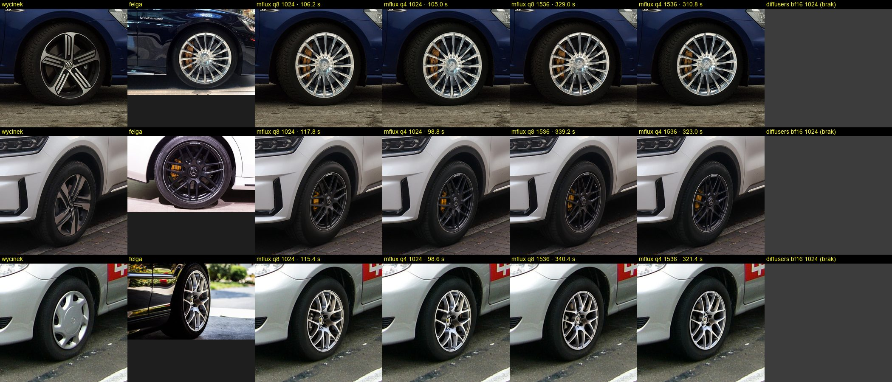
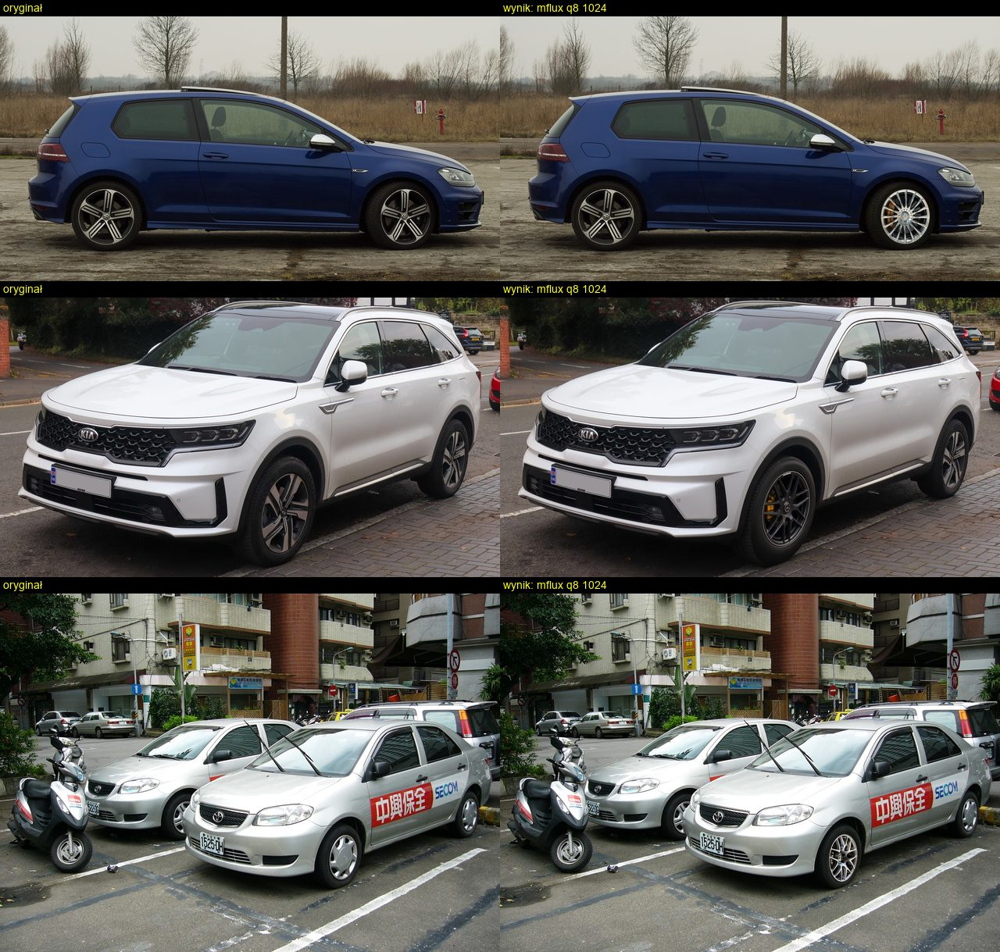
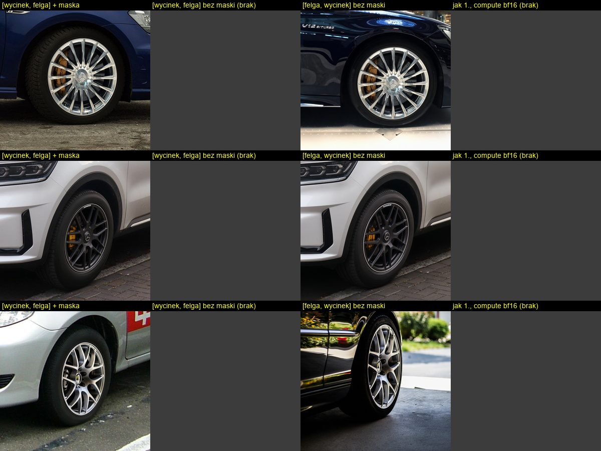
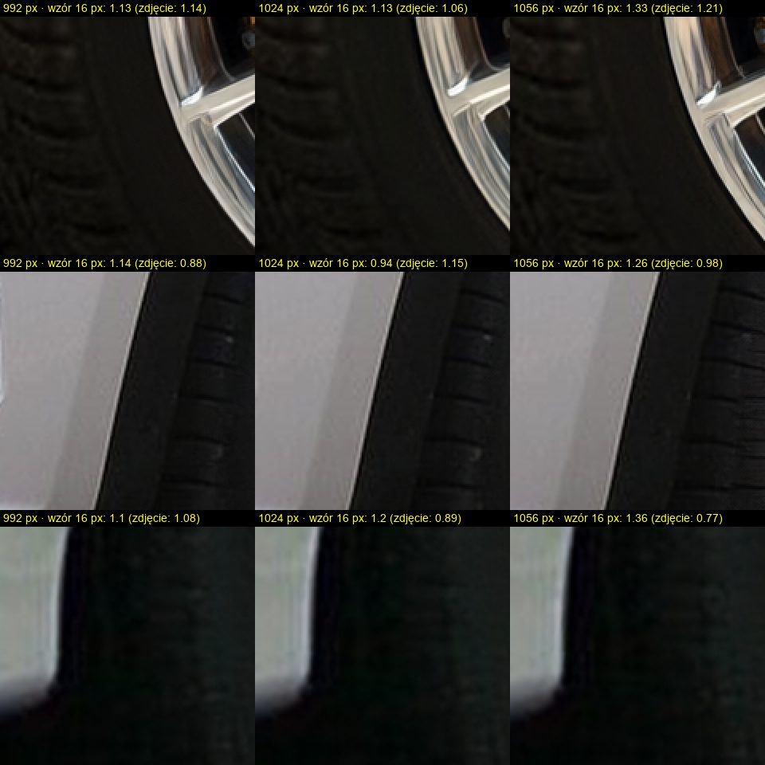
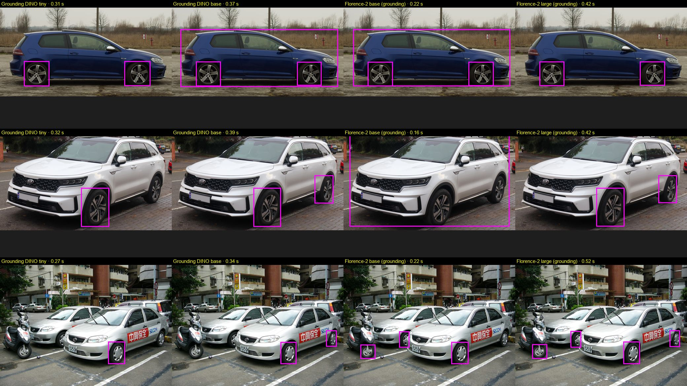
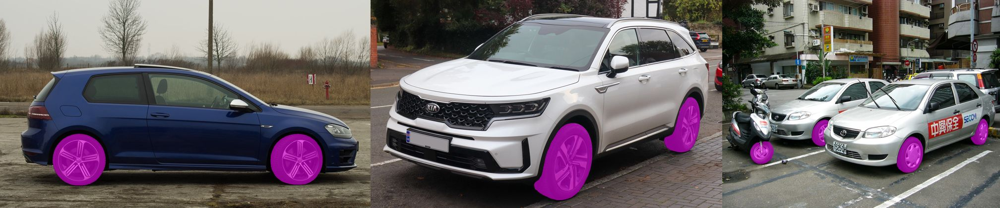

# Spike 01: pomiar modelu i detektora

Data: 2026-10-15. Sprzęt: Apple M2 Max, 32 GB pamięci zunifikowanej, macOS 26.3.1.
W trakcie pomiarów na maszynie działały też inne programy (VM Podmana ~3,7 GB, Firefox ~4 GB), czyli warunki
podobne do docelowych. Każde uruchomienie modelu szło przez wspólną blokadę GPU, więc pomiary się nie nakładały.

Kod: [`spike/`](../../spike) (osobny projekt uv). Surowe wyniki (`spike/out/`) nie są w repo, tylko rysunki.

## Wnioski w skrócie

| Ustawienie | Wartość domyślna | Dlaczego |
| --- | --- | --- |
| Silnik | mflux z `main` (commit `b534021a`), `QwenImage21Edit` | Turbo nie ma jeszcze w wydanym 0.22.0 |
| Kwantyzacja | **q8** (q4 jako tryb oszczędny) | q4 nie jest szybsze, a q8 wierniej oddaje kształt felgi |
| Precyzja obliczeń | **`compute_precision=mx.float16`** | -27% czasu kroku, bez widocznej różnicy jakości |
| Rozdzielczość robocza | **1024 px** (pole 1024², boki co 32 px) | 1536 px jest 3× wolniejsze i przekracza pamięć; siatki przy 1024 brak |
| Referencje | `[wycinek, felga]` + `mask_image`, jawne `width`/`height` | maska mflux działa na pierwszej referencji |
| VAE | `TilingConfig()` (kafelkowy dekoder) | bez tego +14 GB szczytu przy dekodowaniu |
| Detektor | **Florence-2-large**, `<CAPTION_TO_PHRASE_GROUNDING>wheel` | 7/7 kół, ~0,5 s |
| Maski | SAM 2.1 hiera-large (transformers), prompt box | ~0,3 s na zdjęcie |
| Wycinek | kwadrat, margines 25% boku koła z każdej strony | koło zajmuje ~2/3 wycinka |
| Maska kompozycji | maska SAM poszerzona o 3% boku koła, wygładzenie 1,5% do wewnątrz | piksele poza maską bit w bit |

Czas jednego koła (q8, 1024 px): **~110 s**, z czego pierwszy krok ~29 s (prefiks: tekst + 2 obrazy),
kolejne 7 kroków po ~8,8 s. Szczyt pamięci MLX: **26,9 GB** (q8) / 19,1 GB (q4).

## Zdjęcia przykładowe

Sześć zdjęć z Wikimedia Commons, lista autorów i licencji: [`samples/SOURCES.md`](samples/SOURCES.md).
Auta: bok (VW Golf R), 3/4 przodu (Kia Sorento), scena z kołami częściowo zasłoniętymi przez drugie auto
i skuter (Toyota Vios). Felgi: srebrna wieloramienna, czarna 5×2 ramiona, srebrna siatkowa pod kątem.

## Konwersja wag

Z lokalnego cache bf16 (`Qwen/Qwen-Image-2.1-Turbo`, rewizja `fc13ba1`, zgodna z przypięciem w mflux), bez pobierania:

| Wariant | Ścieżka | Rozmiar | Czas zapisu | Szczyt pamięci |
| --- | --- | --- | --- | --- |
| q8 | `~/.cache/wheeler/qwen-image-2.1-turbo-mflux-q8` | 17,8 GB | 15 s | 20,1 GB |
| q4 | `~/.cache/wheeler/qwen-image-2.1-turbo-mflux-q4` | 10,0 GB | 10 s | 12,2 GB |

Skrypt: `spike/scripts/convert_weights.py`. Kwantyzowany jest transformer (7B) i text encoder Qwen3-VL (8B, razem
z wieżą wizyjną). Zapis `QwenImage21Edit.save_model` ładuje się w obu komendach mflux (txt2img i edit).

## Edycja: czasy i pamięć (mflux)

Jedno koło = jedno wywołanie `generate_image` z `image_paths=[wycinek, felga]`, maską i 8 krokami. Średnia z 3 kół
(Golf, Sorento, Vios), każde z inną felgą. Ładowanie mierzone osobno (`mx.eval(model.parameters())`).
Wszystkie wiersze: fp16 compute, kafelkowy VAE, `mx.set_cache_limit(2 GB)`.

| Kwant. | Rozdz. | Ładowanie | Wagi w pamięci | Całe koło | 1. krok | Kolejne kroki | Szczyt MLX |
| --- | --- | --- | --- | --- | --- | --- | --- |
| q8 | 1024 | 4,4 s | 18,5 GB | 113 s (106–118) | 30 s | 8,8 s | 26,9 GB |
| q4 | 1024 | 2,4 s | 10,6 GB | 101 s (99–105) | 25 s | 9,0 s | 19,1 GB |
| q8 | 1536 | 4,3 s | 18,5 GB | 336 s (329–340) | 82 s | 29,9 s | 35,7 GB (swap) |
| q4 | 1536 | 2,2 s | 10,6 GB | 318 s (311–323) | 74 s | 30,0 s | 29,5 GB |
| q8 | 992 | – | 18,5 GB | 104 s (100–108) | 28 s | 8,5 s | 26,4 GB |
| q8 | 1056 | – | 18,5 GB | 122 s (118–127) | 33 s | 9,9 s | 27,4 GB |

Rozbicie jednego koła (q8, 1024, z profilu `spike/scripts/profile_phases.py`): kodowanie promptu z obrazami
przez Qwen3-VL ~7 s, 3× enkoder VAE ~3,5 s razem, odszumianie ~90 s, dekoder VAE (kafelki) ~7,7 s.

Obserwacje:

- **q4 nie przyspiesza.** Na M2 Max krok jest ograniczony obliczeniami, nie przepustowością pamięci. q4 oszczędza
  ~8 GB wag i szczytu. Jakość: q8 i q4 dają tę samą felgę, ale q4 częściej lekko zniekształca geometrię ramion
  (rysunek `configs.jpg`).
- **Pierwszy krok jest 3× dłuższy**: liczy prefiks (tekst + 2 referencje po 4096 tokenów) i zapisuje go w KV cache
  (~4,4 GB). Kolejne kroki liczą tylko 4096 tokenów celu.
- **1536 px odpada**: 3× wolniej, q8 przekracza 32 GB (swap), a jakość na wycinku koła nie jest wyraźnie lepsza.
- **Bez kafelkowego VAE** dekoder dokłada ~14 GB (szczyt 32,4 GB przy q8 1024, zmierzony swap do 11,7 GB).
- **fp16 compute** (`compute_precision=mx.float16`, PR mflux #820): krok 8,8 s zamiast 12,1 s (q4) / ~15 s (q8).
- **Szczyt 26,9 GB przy q8 to dużo jak na 32 GB.** Z VM Podmana (2 GB) i przeglądarką mieści się, ale bez dużego
  zapasu. Jeśli w praktyce pojawi się swap, ustawienie q4 jest bezpiecznym zapasowym trybem (19 GB).

### Porównanie konfiguracji

Kolumny: wycinek, felga, mflux q8/q4 × 1024/1536, diffusers bf16. Czas = całe koło.



### Wynik w oryginale

Wycinek po edycji jest skalowany z powrotem i wklejany przez poszerzoną maskę SAM z miękką krawędzią
(`spike/src/wheeler_spike/wheel_crop.py`). Sprawdzone automatycznie: we wszystkich 3 przypadkach każdy piksel
poza maską jest identyczny z oryginałem.



## Punkt odniesienia: diffusers bf16

DIFFUSERS_PLACEHOLDER

## Kolejność referencji i maska

VARIANTS_PLACEHOLDER



## Siatka 1024 px vs 992 / 1056

ComfyUI #16435 zgłasza szum przy siatce dokładnie 1024 px. Sprawdziliśmy to na wszystkich 3 kołach przy q8:

- Wzrokowo (powiększenie 2× bez interpolacji, opona i krawędź felgi) nie widać siatki ani szumu przy żadnym rozmiarze.
- Miara „wzór 16 px” (`tile_coherence` w `spike/scripts/figures_edit.py`): obraz po filtrze górnoprzepustowym
  składamy modulo 16 px, czyli rozmiar kafla latentu. Bez siatki wynik ≈ 1. Kalibracja: ta sama generacja
  z dopisaną siatką 16 px o amplitudzie 1 i 2 poziomów jasności daje 1,78 i 2,98.
  Wyniki generacji: 992 px 1,10–1,14, **1024 px 0,94–1,20**, 1056 px 1,26–1,36. Dla porównania wejściowe
  zdjęcia (bez modelu) dają 0,77–1,21.

Wniosek: przy edycji wycinka z dwiema referencjami 1024 px nie ma szumu siatki. 992 px jest o ~5% szybsze bez
widocznej różnicy, ale schodzi poniżej progu, pod którym Turbo według mflux zaczyna tracić detal. 1056 px jest
o ~8% wolniejsze bez widocznego zysku. Zostajemy przy 1024.



## Detektor kół: Florence-2 vs Grounding DINO

Trzy zdjęcia, razem 7 kół aut do znalezienia (Golf 2, Sorento 2, scena Vios 3: dwa koła Viosa i częściowo
zasłonięte przednie koło drugiego auta). Koła małych aut w tle i koło skutera nie są liczone jako cel.
Model na MPS, czas po rozgrzaniu (pierwsze wywołanie po załadowaniu ~3 s dłużej).

| Detektor | Trafione | Fałszywe | Czas na zdjęcie | Pamięć MPS | Ładowanie |
| --- | --- | --- | --- | --- | --- |
| **Florence-2-large**, grounding „wheel” (fp16) | **7/7** | 1 (koło skutera) | 0,42–0,52 s | 2,8 GB | 1,4 s |
| Florence-2-base, grounding | 4/7 | 3 (całe auto ×2, skuter) | 0,16–0,22 s | 1,4 GB | 0,8 s |
| Grounding DINO base, „a car wheel.”, próg 0,35 | 6/7 | 1 (całe auto) | 0,34–0,39 s | 4,7 GB | 0,7 s |
| Grounding DINO tiny, jw. | 4/7 | 0 | 0,27–0,32 s | 4,6 GB | 0,6 s |

Sprawdzone też `<OD>` Florence-2 z filtrem etykiet: znajduje wszystkie koła, ale także kierownicę („steering
wheel”) i drobne koła w tle, więc odpada. Checkpointy: `florence-community/Florence-2-large` (natywnie w
transformers 5.19, bez `trust_remote_code`), `IDEA-Research/grounding-dino-{tiny,base}`.



**Wybór: Florence-2-large z frazą „wheel”.** Najwyższa trafność przy podobnym czasie. Koło skutera jako fałszywy
alarm jest akceptowalne, bo UI pozwala usunąć maskę kliknięciem.

### Maski SAM 2.1

`facebook/sam2.1-hiera-large` przez transformers (`Sam2Model`, wymaga `torchvision`), prompt = box z detektora:
ładowanie 0,5 s, embedding obrazu 0,28 s, dekoder ~0,02 s, pamięć MPS 2,9 GB. Maski obejmują oponę z felgą,
także przy kole częściowo zasłoniętym. Detekcja + maski to razem poniżej 1 s na zdjęcie.



SAM_POINT_PLACEHOLDER

## Szablon promptu

Obraz 1 = wycinek koła, obraz 2 = felga:

```
Replace the rim of the car wheel in image 1 with the alloy rim design shown in image 2. Keep the tire, the car
body, the wheel arch, the brake caliper position, the lighting, the shadows and the camera angle of image 1
unchanged. The new rim must follow the perspective of the wheel in image 1 and fill the tire opening exactly.
Photorealistic.
```

Model przenosi projekt felgi z perspektywą koła docelowego, zachowuje oponę, nadkole i oświetlenie. Przenosi też
zacisk hamulcowy widoczny na zdjęciu felgi (żółty/złoty AMG). Felga z wyciętym tłem (ticket 06) powinna to
ograniczyć. Ewentualny dopisek w rodzaju „do not copy the brake caliper” zostawiamy do sprawdzenia w tickecie 03.

## Stan mflux i pułapki

- Wydane mflux 0.22.0 (2026-10-08) obsługuje Qwen-Image-2.1, ale nie Turbo. Turbo trafiło na `main` w PR #859
  (2026-10-13): `ModelConfig.qwen_image_21_turbo()`, 8 kroków na stałych `sample_sigmas`. Do czasu wydania
  przypinamy commit z gita (`spike/pyproject.toml`).
- mflux przypina też rewizję HF Turbo (`fc13ba1…`), zgodną z naszym cache, więc działa offline (`HF_HUB_OFFLINE=1`).
- `mask_image` działa na pierwszej referencji, a proporcje wyjścia bierze z ostatniej. Stąd `[wycinek, felga]`
  i jawne `width`/`height`.
- `output_resolution` to budżet pikseli dla każdej referencji, także felgi (4096 tokenów). Mniejszy budżet
  dla samej felgi skróciłby pierwszy krok, ale mflux nie ma na to parametru.

## Odtworzenie

```sh
cd spike && uv sync
G=…/scratchpad/gpu-run.sh
$G uv run python scripts/convert_weights.py 8 && $G uv run python scripts/convert_weights.py 4
$G uv run python scripts/detect_wheels.py florence2-large   # oraz florence2-base, gdino-tiny, gdino-base
$G uv run python scripts/sam_masks.py facebook/sam2.1-hiera-large
$G uv run python scripts/bench_mflux.py --bits 8 --res 1024  # --bits 4, --res 1536/992/1056, --variant ...
$G /Users/hugo/marcel/image-gen-model-test/.venv/bin/python scripts/diffusers_baseline.py
uv run python scripts/figures_detect.py && PYTHONPATH=scripts uv run python scripts/figures_edit.py
uv run pytest
```
